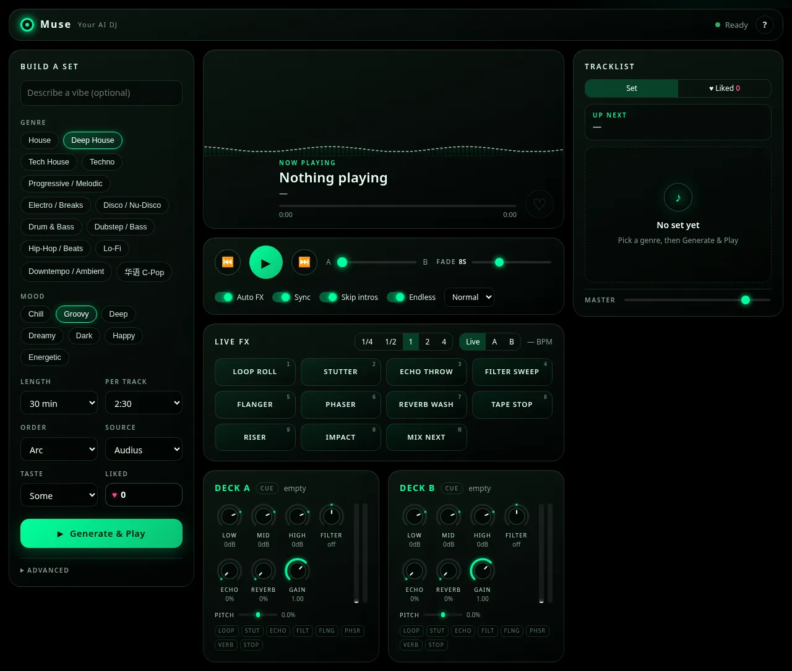

# Muse

**Muse — Your AI DJ**

选个曲风，点一下，浏览器里就有一位 DJ 为你挖歌、排歌单、对拍混音，整场不停。

▶ **在线体验：<https://novain1102.github.io/muse/>**（无需安装、无需账号）



| 正在混音（滤波扫频转场，旋钮实时联动） | 国内音源：酷狗 |
|---|---|
|  |  |


## 功能

- **自动挖歌 + 品味过滤**：按曲风 / 情绪用细分风格关键词搜索，过滤 type beat、加速版、DJ 合集、刷量爆款，偏好"有品的冷门好歌"，同一艺人只取一首。
- **能量曲线排歌**：热场 → 推高 → 高潮 → 收尾；结合 BPM 与 Camelot 调性，减少速度跳变和调性冲突。
- **双 Deck 自动混音**：响度对齐、自动对拍（±8%），转场落在小节 / 乐句上；低音互换、滤波扫频、回声收尾、Loop Roll、混响冲刷、刹盘等脚本化转场。
- **像真人 DJ 一样 ride 参数**：两次转场之间按乐句做克制的 EQ、滤波、增益、回声 / 混响动作；旋钮、电平、推子、音调和效果灯全部实时动画显示，随时可以手动接管（拖动旋钮，双击复位）。
- **现场效果垫**：按住 / 点按或键盘 1–9、0、N 触发，效果标签带进度条，垫子随节拍闪动。
- **♥ 红心与口味**：给喜欢的歌点 ♥，之后的歌单会向你的口味靠拢（关 / 适中 / 强）；支持导出 / 导入。
- **👎 不喜欢**：正在播的歌点一下就快速混到下一首，队列里的歌点一下直接移出；不喜欢的歌不会再出现，同一歌手被踩两次就不再推荐，相似的歌手和风格会按口味强度降权；可在 👎 标签里撤销，导出 / 导入一并带上。
- **华语 C-Pop 类别**：当下的华语说唱 / Trap / Club（Higher Brothers、GAI、马思唯、法老、KEY.L刘聪、Vava、万妮达……），约两成新派 R&B（王以太、刘至佳、Tia Ray袁娅维……）。情绪决定挑哪类歌手：燃 / 暗黑 → 硬核 trap、drill；律动 → bounce 说唱和 R&B；放松 / 梦幻 → 旋律说唱；快乐 → 派对说唱；深沉 → 深夜 trap。优先酷狗（海外也能播），其次 QQ 音乐；只选原唱，排除 DJ 版、remix、伴奏、翻唱，平台有发行年份时过滤 2016 年以前的老歌。
- **播放中换风格**：中途切换曲风 / 情绪，约 1.5 秒后自动重新挖歌，保留当前和下一首，用 BRIDGE 过渡曲平滑转到新风格。
- **多音源**：

  | 音源 | 内容 |
  |---|---|
  | Audius（默认） | 独立音乐人完整曲目，自带 BPM / 调性 |
  | 酷狗 | 平台免费提供的完整歌曲，无需代理 |
  | QQ 音乐 | 免费歌曲，**仅中国大陆网络可播放**，其他地区自动改用 Audius |
  | 网易云 | 需自建一个小代理（[部署说明](providers/proxy/README.md)），在"高级"中填写后出现 |
  | iTunes | 30 秒试听，作为备用 |

- **新手引导**：首次打开有 4 步引导（选曲风 → 情绪 → 生成 → ♥），右上角 **?** 可重看。

## 技术原理

整套 DJ 是**浏览器里 100% 脚本化的 Web Audio**，没有服务器，播放过程中**不消耗任何 AI token**。
"高级"里的关键词扩展是可选项，默认关闭；开启后每次生成最多调用一次（用你自己的 key），结果会缓存。

```
找歌筛歌 → 听歌分析 → 排歌单 → 混音转场 → 实时 ride → 动态转向
```

1. **找歌筛歌**：各音源的搜索接口 + 关键词表（中英文），按规则打分过滤，结合你的 ♥ 口味加权。
2. **听歌分析**：在浏览器里解码音频片段，用起音自相关测 BPM 和拍点相位，并测响度和能量。
3. **排歌单**：按能量曲线排序，尽量让相邻曲目的 BPM 接近、调性在 Camelot 轮上相容。
4. **混音转场**：两个 Deck 各有 EQ、滤波、延迟、混响、镶边、相位等节点，转场按拍点精确调度。
5. **实时 ride**：每个 16 拍乐句最多一个动作，界面上的旋钮直接读取真实的音频参数。
6. **动态转向**：换风格后在后台重新挖歌，加入过渡曲，并重新排列后面的歌单。

## 本地运行

```bash
git clone https://github.com/novain1102/muse.git && cd muse
python3 -m http.server 8000      # 打开 http://localhost:8000
```

也可以直接双击 `index.html`（纯静态，无需构建）。酷狗 / QQ 音乐可在 `file://` 下使用；iTunes 不支持 `file://`。

## 添加音源

每个音源是 `providers/` 里的一个文件，实现 `search()` 和 `getStreamUrl()`，返回统一的 Track 格式即可。详见 [providers/README.md](providers/README.md)。

## 局限

- Audius 是独立音乐人平台，不是商业榜单；音质和风格参差不齐，频繁生成可能被限流。
- 拍点和乐句对齐是估算，偶尔会有转场漂移或没落在乐句上。
- 华语大热歌曲很多是酷狗付费歌曲，会被跳过；能播的是平台免费提供的那部分。连续多次生成时酷狗可能暂时限流，歌单会变短（无限模式会继续补歌）。
- 国内平台没有 BPM / 调性数据（由浏览器自行测量），搜索结果相关性一般，可能混入"DJ 版"流行歌。
- 网易云经代理访问时，平台按代理 IP 判断地区，海外代理只能播放部分歌曲。

## 关于音源

酷狗、QQ 音乐、网易云使用的都是平台的**非官方网页接口**，随时可能变动。Muse 只播放平台向匿名用户免费提供的内容：不登录、不使用 Cookie、不伪装地区、不绕过 VIP / 付费限制，也不使用任何第三方"解锁"镜像。请遵守各平台的用户协议。

---

更详细的英文技术说明见 [docs/DETAILS.md](docs/DETAILS.md)。
